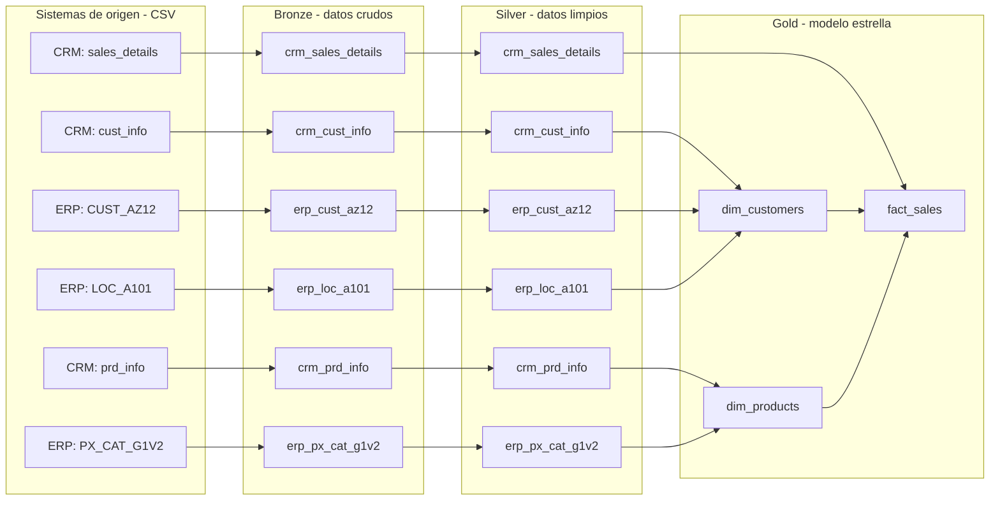

# Arquitectura y flujo de datos

Almacén de datos en SQL Server con **arquitectura Medallion**. Una sola base de datos (`data_warehouse`) con tres esquemas, uno por capa.

## Capas

| Capa | Esquema | Objetos | Responsabilidad |
|---|---|---|---|
| Bronze | `bronze` | 6 tablas | Datos originales, tal como vienen de los CSV (sin transformar) |
| Silver | `silver` | 6 tablas | Datos limpios, estandarizados y con tipos correctos |
| Gold | `gold` | 2 dimensiones y 1 tabla de hechos (vistas) | Modelo en estrella listo para análisis |

## Flujo de datos

## Procesos de carga

| Paso | Procedimiento / script | Qué hace |
|---|---|---|
| Bronze | `bronze.load_bronze` (`BULK INSERT`) | Vacía y carga los 6 CSV sin modificar |
| Silver | `silver.load_silver` | Limpia, estandariza e inserta (Bronze → Silver) |
| Gold | `gold/ddl_gold.sql` (vistas) | Integra CRM y ERP en dimensiones y hechos |

Cada capa se alimenta únicamente de la anterior. Gold siempre refleja lo que hay en Silver, porque son vistas.

## Cómo se relacionan las fuentes

| Entidad | CRM | ERP | Llave de unión |
|---|---|---|---|
| Cliente | `cust_info` (`cst_key`) | `CUST_AZ12` (`CID`, con prefijo `NAS`), `LOC_A101` (`CID`, con guion) | `cst_key = cid`, tras limpiar el prefijo y los guiones en Silver |
| Producto | `prd_info` (`prd_key`) | `PX_CAT_G1V2` (`ID`) | `cat_id` extraído de `prd_key`, con `-` reemplazado por `_` |
| Ventas | `sales_details` | — | `sls_cust_id = cst_id`, `sls_prd_key = prd_key` |

## Alcance

Según los requisitos, solo se trabaja con el conjunto de datos más reciente y no se mantiene historial. Por eso `dim_products` solo contiene la versión vigente de cada producto (`prd_end_dt IS NULL`) y las cargas vacían las tablas antes de insertar.
