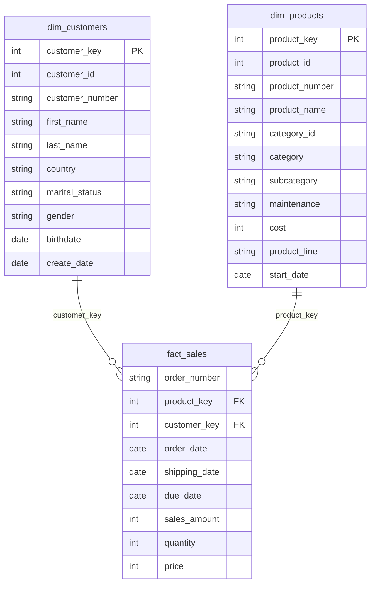

# Modelo de datos: capa Gold

Modelo dimensional en **esquema de estrella**: una tabla de hechos (`fact_sales`) rodeada de dos dimensiones (`dim_customers` y `dim_products`).



## gold.dim_customers

**Propósito:** información de clientes enriquecida con datos del ERP (país, fecha de nacimiento, género de respaldo). Una fila por cliente.

| Columna | Tipo | Descripción |
|---|---|---|
| `customer_key` | INT | Clave subrogada (identificador generado en el almacén) |
| `customer_id` | INT | Identificador numérico del cliente en el CRM |
| `customer_number` | NVARCHAR | Código alfanumérico del cliente (ej. `AW00011000`) |
| `first_name` | NVARCHAR | Nombre |
| `last_name` | NVARCHAR | Apellido |
| `country` | NVARCHAR | País de residencia (`n/a` si no hay dato) |
| `marital_status` | NVARCHAR | `Single`, `Married` o `n/a` |
| `gender` | NVARCHAR | `Female`, `Male` o `n/a`. Se toma del CRM; si no tiene dato, del ERP |
| `birthdate` | DATE | Fecha de nacimiento (nula si no hay dato o era una fecha futura) |
| `create_date` | DATE | Fecha de creación del registro en el CRM |

## gold.dim_products

**Propósito:** catálogo de productos vigentes con su categoría. Una fila por producto.

| Columna | Tipo | Descripción |
|---|---|---|
| `product_key` | INT | Clave subrogada |
| `product_id` | INT | Identificador del producto en el CRM |
| `product_number` | NVARCHAR | Código del producto (ej. `FR-R92B-58`) |
| `product_name` | NVARCHAR | Nombre del producto |
| `category_id` | NVARCHAR | Código de categoría (ej. `CO_RF`) |
| `category` | NVARCHAR | Categoría (ej. `Bikes`); `n/a` si no existe en el ERP |
| `subcategory` | NVARCHAR | Subcategoría; `n/a` si no existe en el ERP |
| `maintenance` | NVARCHAR | Si requiere mantenimiento (`Yes`/`No`) |
| `cost` | INT | Costo base del producto (0 si no estaba registrado) |
| `product_line` | NVARCHAR | `Mountain`, `Road`, `Touring`, `Other Sales` o `n/a` |
| `start_date` | DATE | Fecha desde la que el producto está vigente |

## gold.fact_sales

**Propósito:** transacciones de ventas para análisis. Una fila por línea de pedido.

| Columna | Tipo | Descripción |
|---|---|---|
| `order_number` | NVARCHAR | Número de pedido (ej. `SO43697`) |
| `product_key` | INT | Llave hacia `dim_products` |
| `customer_key` | INT | Llave hacia `dim_customers` |
| `order_date` | DATE | Fecha del pedido (nula en 19 registros con dato inválido en el origen) |
| `shipping_date` | DATE | Fecha de envío |
| `due_date` | DATE | Fecha de vencimiento |
| `sales_amount` | INT | Monto de la venta (cantidad × precio) |
| `quantity` | INT | Unidades vendidas |
| `price` | INT | Precio por unidad |

## Ejemplo de uso

```sql
-- Ventas totales por categoría y país
SELECT p.category, c.country, SUM(f.sales_amount) AS total_ventas
FROM gold.fact_sales AS f
JOIN gold.dim_products  AS p ON p.product_key  = f.product_key
JOIN gold.dim_customers AS c ON c.customer_key = f.customer_key
GROUP BY p.category, c.country
ORDER BY total_ventas DESC;
```
